# Diagrama Entidad-Relación (ERD) - Rosas de Guadalupe Management System

Este documento contiene el modelo de datos relacional completo implementado en **Oracle Database 21c (PDB: XEPDB1)** bajo el esquema **`ROSAS_ADMIN`**. Cubre las **11 tablas** del sistema, sus claves primarias, foráneas, restricciones de negocio y cardinalidades, con **100% de integridad referencial** (sin tablas aisladas).

---

## 1. Diagrama Entidad-Relación Completo (Mermaid)

```mermaid
erDiagram
    CLIENTES ||--o{ EVENTOS_RESERVAS : "registra (1:N)"
    FORMATOS_MARIACHI ||--o{ EVENTOS_RESERVAS : "contrata (1:N)"
    ZONAS_COBERTURA ||--o{ EVENTOS_RESERVAS : "ubica (1:N)"
    ESTADOS_RESERVA ||--o{ EVENTOS_RESERVAS : "clasifica_estado (1:N)"
    EVENTOS_RESERVAS ||--|| ANTICIPOS : "garantiza_anticipo_50 (1:1)"
    EVENTOS_RESERVAS ||--o{ PAGOS : "recibe_abonos (1:N)"
    EVENTOS_RESERVAS ||--o{ RESERVA_CANCIONES : "incluye_setlist (1:N)"
    CANCIONES ||--o{ RESERVA_CANCIONES : "interpretada_en (1:N)"
    EVENTOS_RESERVAS ||--o{ RESERVA_INTEGRANTES : "asigna_elenco (1:N)"
    INTEGRANTES_MARIACHI ||--o{ RESERVA_INTEGRANTES : "participa_en (1:N)"

    CLIENTES {
        NUMBER id_cliente PK "Identity"
        VARCHAR2 nombre "Nombre(s)"
        VARCHAR2 apellido "Apellidos"
        VARCHAR2 telefono "Contacto WhatsApp/Cel"
        VARCHAR2 email UK "Correo único"
        VARCHAR2 direccion_referencia "Dirección del cliente"
        TIMESTAMP fecha_registro "Fecha de alta"
    }

    ZONAS_COBERTURA {
        NUMBER id_zona PK "Identity"
        VARCHAR2 nombre_zona "Centro, Norte, Sur, Campestre"
        VARCHAR2 descripcion "Rango de cobertura"
        NUMBER recargo_transporte "Costo logística en S/"
        NUMBER tiempo_estimado_traslado_min "Minutos de viaje"
        CHAR activo "S / N"
    }

    FORMATOS_MARIACHI {
        NUMBER id_formato PK "Identity"
        VARCHAR2 nombre_formato "Mariachi completo, Express 1/2, Express dúo, Solista"
        VARCHAR2 descripcion "Detalle del espectáculo"
        NUMBER num_musicos "6 integrantes fijas"
        NUMBER precio_base_hora "Precio en Soles S/"
        CHAR incluye_equipo_audio "S / N"
        CHAR activo "S / N"
    }

    INTEGRANTES_MARIACHI {
        NUMBER id_integrante PK "Identity"
        VARCHAR2 nombre_completo "Nombre de la música"
        VARCHAR2 instrumento_rol "Voz, Trompeta, Vihuela, Guitarrón"
        VARCHAR2 telefono "Contacto interno"
        CHAR es_lider "S: Directora / N: Músico"
        CHAR activo "S / N"
    }

    ESTADOS_RESERVA {
        NUMBER id_estado PK "Identity"
        VARCHAR2 codigo UK "COTIZADA, ANTICIPO_PAGADO, CONFIRMADA, LIQUIDADA, CANCELADA"
        VARCHAR2 nombre "Nombre visible"
        VARCHAR2 descripcion "Significado en el flujo"
        CHAR es_final "S / N"
        NUMBER orden_flujo "1..5"
    }

    EVENTOS_RESERVAS {
        NUMBER id_reserva PK "Identity"
        VARCHAR2 codigo_reserva UK "RS-2026-XXX"
        NUMBER id_cliente FK "Ref a CLIENTES"
        NUMBER id_formato FK "Ref a FORMATOS_MARIACHI"
        NUMBER id_zona FK "Ref a ZONAS_COBERTURA"
        DATE fecha_evento "Fecha del espectáculo"
        VARCHAR2 hora_inicio "Hora acordada (HH:MI)"
        NUMBER duracion_horas "Duración contratada"
        VARCHAR2 direccion_evento "Ubicación del evento"
        VARCHAR2 tipo_evento "Cumpleaños, Boda, 15 Años..."
        VARCHAR2 estado_reserva FK "Ref a ESTADOS_RESERVA"
        NUMBER monto_subtotal "Costo base musical (S/)"
        NUMBER recargo_zona "Logística de traslado (S/)"
        NUMBER monto_total "Subtotal + Recargo (S/)"
        NUMBER anticipo_requerido "50% obligatorio (S/)"
        NUMBER saldo_pendiente "50% por liquidar (S/)"
        VARCHAR2 notas_logistica "Acceso, sorpresas, audio"
        VARCHAR2 metodo_pago_preferido "Método elegido para el anticipo"
        TIMESTAMP fecha_creacion "Auditoría registro"
    }

    ANTICIPOS {
        NUMBER id_anticipo PK "Identity"
        NUMBER id_reserva FK,UK "Relación 1:1 estricta"
        NUMBER monto_anticipo "50% en Soles (S/)"
        NUMBER monto_saldo "50% restante (S/)"
        NUMBER porcentaje "Default 50.00%"
        DATE fecha_limite_saldo "Fecha máxima pago saldo"
        VARCHAR2 estado "PENDIENTE, PAGADO, VENCIDO, REEMBOLSADO"
        TIMESTAMP fecha_creacion "Auditoría registro"
    }

    PAGOS {
        NUMBER id_pago PK "Identity"
        NUMBER id_reserva FK "Ref a EVENTOS_RESERVAS"
        NUMBER monto "Monto abonado (S/)"
        VARCHAR2 metodo_pago "EFECTIVO, YAPE, PLIN, TRANSFERENCIA, TARJETA_CREDITO, TARJETA_DEBITO"
        NUMBER comision "5% tarjeta, 0% otros (S/)"
        VARCHAR2 num_operacion "Comprobante de operación bancaria"
        VARCHAR2 tipo_pago "ANTICIPO / SALDO"
        TIMESTAMP fecha_pago "Momento de la transacción"
    }

    CANCIONES {
        NUMBER id_cancion PK "Identity"
        VARCHAR2 titulo "Título de la canción"
        VARCHAR2 autor "Compositor / Autor"
        VARCHAR2 genero "Ranchera, Cumbia, Bolero, etc."
        NUMBER duracion_aprox "Duración en minutos"
        CHAR es_cover "S / N"
        CHAR disponible "S / N"
        TIMESTAMP fecha_registro "Auditoría registro"
    }

    RESERVA_CANCIONES {
        NUMBER id_reserva_cancion PK "Identity"
        NUMBER id_reserva FK "Ref a EVENTOS_RESERVAS"
        NUMBER id_cancion FK "Ref a CANCIONES"
        CHAR es_dedicatoria "S / N"
        NUMBER orden "Posición en el repertorio"
        VARCHAR2 observaciones "Para quién es la canción, etc."
    }

    RESERVA_INTEGRANTES {
        NUMBER id_reserva_integrante PK "Identity"
        NUMBER id_reserva FK "Ref a EVENTOS_RESERVAS"
        NUMBER id_integrante FK "Ref a INTEGRANTES_MARIACHI"
        VARCHAR2 rol_en_evento "Rol específico en la fecha"
        CHAR asistencia_confirmada "S / N"
    }
```

---

## 2. Matriz de Tablas, Claves y Relaciones

| # | Tabla | Tipo de Entidad | Clave Primaria (PK) | Claves Foráneas (FK) | Restricciones Clave |
|---|-------|-----------------|---------------------|----------------------|---------------------|
| 1 | `CLIENTES` | Maestra / Catálogo | `id_cliente` | - | `email UNIQUE` |
| 2 | `ZONAS_COBERTURA` | Maestra / Catálogo | `id_zona` | - | `activo IN ('S','N')` |
| 3 | `FORMATOS_MARIACHI` | Maestra / Catálogo | `id_formato` | - | `num_musicos DEFAULT 6`, `activo IN ('S','N')` |
| 4 | `INTEGRANTES_MARIACHI` | Maestra / Catálogo | `id_integrante` | - | `es_lider IN ('S','N')`, `activo IN ('S','N')` |
| 5 | `ESTADOS_RESERVA` | Catálogo de Dominio | `id_estado` | - | `codigo UNIQUE`, `orden_flujo` |
| 6 | `EVENTOS_RESERVAS` | Transaccional Central | `id_reserva` | `id_cliente`, `id_formato`, `id_zona`, `estado_reserva` | `codigo_reserva UNIQUE`, `chk_reserva_estado` |
| 7 | `ANTICIPOS` | Regla de Negocio 1:1 | `id_anticipo` | `id_reserva (UNIQUE)` | `porcentaje DEFAULT 50.00`, `chk_anticipo_estado` |
| 8 | `PAGOS` | Transaccional 1:N | `id_pago` | `id_reserva` | `chk_pago_tipo`, `chk_pago_metodo` |
| 9 | `CANCIONES` | Maestra / Catálogo | `id_cancion` | - | `chk_genero`, `disponible IN ('S','N')` |
| 10 | `RESERVA_CANCIONES` | Asociativa (M:N) | `id_reserva_cancion` | `id_reserva`, `id_cancion` | `es_dedicatoria IN ('S','N')` |
| 11 | `RESERVA_INTEGRANTES` | Asociativa (M:N) | `id_reserva_integrante` | `id_reserva`, `id_integrante` | `UNIQUE(id_reserva, id_integrante)` |

---

## 3. Justificación de Criterios de Base de Datos y Formas Normales

1. **Primera Forma Normal (1NF)**:
   - Todas las columnas contienen valores atómicos (ej. no hay listas de canciones o listas de músicos concatenadas en strings).
   - Cada tabla posee una clave primaria unívoca autogenerada vía `GENERATED ALWAYS AS IDENTITY`.

2. **Segunda Forma Normal (2NF)**:
   - Se cumple 1NF y no existen dependencias parciales. Las tablas asociativas (`RESERVA_CANCIONES`, `RESERVA_INTEGRANTES`) usan claves primarias subrogadas con restricciones `UNIQUE` compuestas, garantizando que los atributos descriptivos dependan de toda la relación.

3. **Tercera Forma Normal (3NF)**:
   - Se eliminaron las dependencias transitivas: los datos del cliente residen en `CLIENTES`, los detalles de tarifas en `FORMATOS_MARIACHI`, y los recargos en `ZONAS_COBERTURA`.
   - **Instantánea de Facturación (Snapshot):** En `EVENTOS_RESERVAS`, los montos (`monto_subtotal`, `recargo_zona`, `monto_total`, `anticipo_requerido`, `saldo_pendiente`) se almacenan de forma histórica. Esto sigue el estándar bancario y de facturación electrónica: si el precio de un formato aumenta en el futuro, las reservas pasadas no sufren alteración contable.

4. **Integridad Referencial Absoluta (0 Tablas Aisladas)**:
   - `ESTADOS_RESERVA` se vincula directamente a `EVENTOS_RESERVAS` mediante `CONSTRAINT fk_reserva_estado`.
   - `INTEGRANTES_MARIACHI` se vincula operacionalmente mediante `RESERVA_INTEGRANTES`, permitiendo rastrear qué elenco artístico de 6 músicas está convocado y confirmó asistencia para cada evento.
