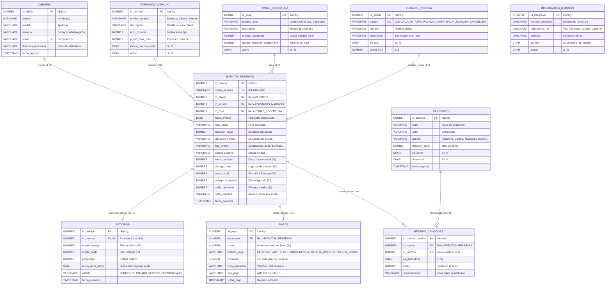

# Diagrama Entidad-Relación (ERD) - Rosas de Guadalupe Management System

Este documento contiene el modelo de datos relacional completo implementado en **Oracle Database 21c (PDB: XEPDB1)** bajo el esquema **`ROSAS_ADMIN`**. Cubre las 10 tablas del sistema, sus claves primarias, foráneas, restricciones de negocio y cardinalidades.

---

## 1. Diagrama Entidad-Relación Completo (Mermaid)

---

## 2. Cardinalidades y Reglas de Negocio Implementadas

### 2.1 Contratación y Formatos (`clientes`, `formatos_mariachi`, `zonas_cobertura` ───< `eventos_reservas`)
* **1:N Clientes a Reservas:** Un cliente puede contratar múltiples presentaciones.
* **1:N Formatos a Reservas:** Formatos estándar con precios oficiales en Soles (`S/ 2,200`, `S/ 2,800`, `S/ 5,200`).
* **1:N Zonas a Reservas:** Tarifa plana para Zona Centro (`S/ 0.00`), Periferia Norte/Sur (`S/ 250.00`) y Campestre (`S/ 600.00`).

### 2.2 Política Financiera 50/50 y Relación 1:1 de Anticipos (`eventos_reservas` ||───|| `anticipos`)
* Cada reserva genera exactamente un registro en la tabla `anticipos` mediante la restricción `CONSTRAINT uq_anticipos_reserva UNIQUE (id_reserva)`.
* **Cálculo:** `monto_total = monto_subtotal + recargo_zona`.
* **Anticipo obligatorio:** `monto_total * 0.50` para bloquear la agenda.
* **Saldo restante:** `monto_total * 0.50` a liquidar antes de iniciar la presentación.

### 2.3 Pagos y Canales Peruanos (`eventos_reservas` 1───< N `pagos`)
* **Canales admitidos:** `EFECTIVO`, `YAPE`, `PLIN`, `TRANSFERENCIA`, `TARJETA_CREDITO`, `TARJETA_DEBITO`.
* **Regla de Comisión (RS-128 / RS-137):**
  * Tarjetas de Crédito / Débito: **5.00%** calculado sobre el monto abonado.
  * Transferencias y Billeteras digitales (Yape, Plin): **0.00%**.
* **Tipo de Pago:** Clasificado estrictamente en `ANTICIPO` o `SALDO`.

### 2.4 Repertorio Musical y Setlist (`eventos_reservas` N───M `canciones` vía `reserva_canciones`)
* Los clientes pueden armar un setlist personalizado de canciones disponibles en el repertorio, marcando aquellas que son **dedicatorias especiales**.

### 2.5 Integrantes del Mariachi (`integrantes_mariachi`)
* Tabla independiente que gestiona la conformación oficial de **6 músicas profesionales** (2 trompetas, 1 vihuela, 1 guitarrón, 2 cantantes/directora).

---

## 3. Matriz de Claves Foráneas (Integridad Referencial)

| Tabla Origen | Clave Foránea | Tabla Destino | Regla ON DELETE |
|---|---|---|---|
| `ANTICIPOS` | `id_reserva` | `EVENTOS_RESERVAS(id_reserva)` | `CASCADE` |
| `PAGOS` | `id_reserva` | `EVENTOS_RESERVAS(id_reserva)` | `CASCADE` |
| `EVENTOS_RESERVAS` | `id_cliente` | `CLIENTES(id_cliente)` | `NO ACTION` (Protege histórico) |
| `EVENTOS_RESERVAS` | `id_formato` | `FORMATOS_MARIACHI(id_formato)` | `NO ACTION` |
| `EVENTOS_RESERVAS` | `id_zona` | `ZONAS_COBERTURA(id_zona)` | `NO ACTION` |
| `RESERVA_CANCIONES` | `id_reserva` | `EVENTOS_RESERVAS(id_reserva)` | `NO ACTION` |
| `RESERVA_CANCIONES` | `id_cancion` | `CANCIONES(id_cancion)` | `NO ACTION` |

---

## 4. Archivos Relacionados
* [database/diagrams/diagrama_er.html](file:///d:/rosas-de-guadalupe-rs/database/diagrams/diagrama_er.html) - Visualizador interactivo HTML con Pan/Zoom.
* [database/diagrams/esquema_completo.sql](file:///d:/rosas-de-guadalupe-rs/database/diagrams/esquema_completo.sql) - Extracción DDL completa desde Oracle XE 21c (`DBMS_METADATA`).
* [database/diagrams/modelo_pagos.md](file:///d:/rosas-de-guadalupe-rs/database/diagrams/modelo_pagos.md) - Enfoque específico de la subtarea RS-137.
