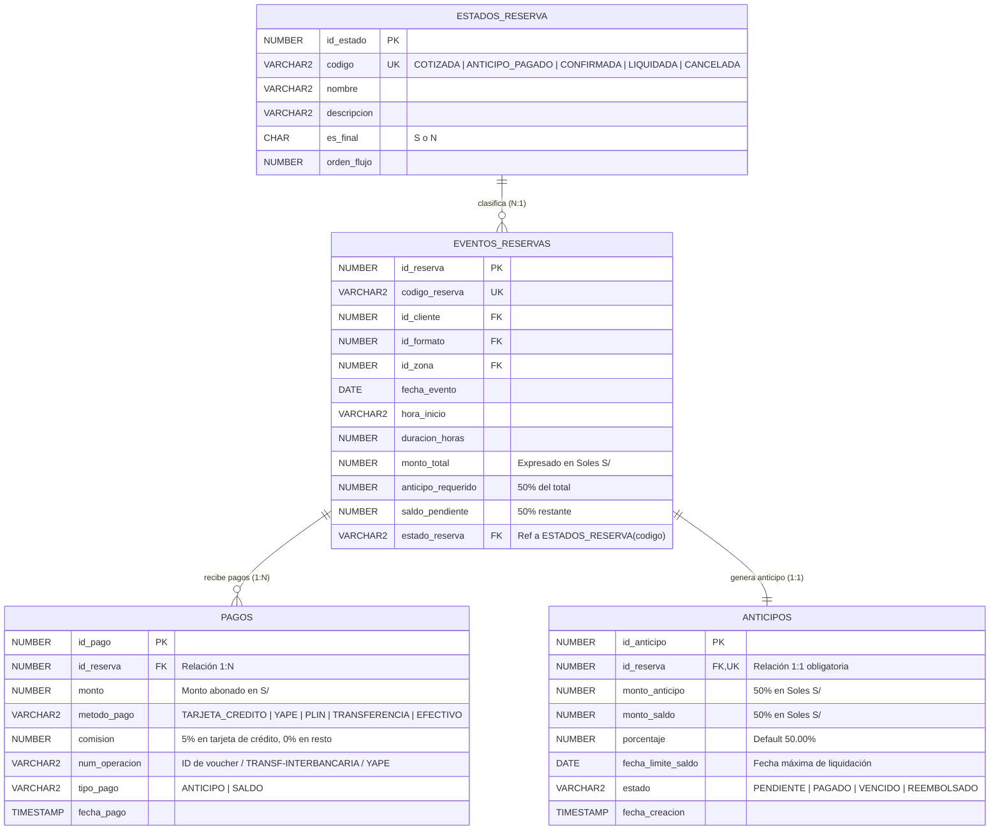

# Modelo de Pagos, Anticipos y Estados (Jira: RS-137)

Este documento describe el modelo relacional de la subtarea **RS-137: "Diseñar modelo de pagos, anticipos y estados"** (perteneciente a la Historia **RS-10 - HU06: Pago del anticipo**).

---

## 1. Diagrama Entidad-Relación (Mermaid)

---

## 2. Cardinalidades y Reglas del Negocio (RS-10, RS-137)

### 2.1 `eventos_reservas` (1) ───< (N) `pagos`
- **Relación 1 a Muchos:** Cada reserva recibe como mínimo dos pagos a lo largo de su ciclo de vida:
  1. **`ANTICIPO` (50%):** Pago inicial para congelar la fecha en el calendario.
  2. **`SALDO` (50%):** Liquidación momentos previos al inicio de la presentación musical.
- También permite registrar abonos por tiempo extra contratado en vivo durante la presentación.

### 2.2 `eventos_reservas` (1) ─── (1) `anticipos`
- **Relación 1 a 1 Estricta:** Cada reserva genera exactamente una proyección financiera de anticipo.
- Se garantiza la unicidad mediante la restricción de integridad `CONSTRAINT uq_anticipos_reserva UNIQUE (id_reserva)`.
- Controla el porcentaje del anticipo (`50.00%`), los montos en Soles (`S/`), la fecha límite para el saldo y el estado del anticipo (`PENDIENTE`, `PAGADO`, `VENCIDO`, `REEMBOLSADO`).

---

## 3. Política de Comisiones por Medio de Pago en Perú

| Método de Pago | Comisión Aplicada | Justificación de Negocio | Registro en `pagos` |
|---|:---:|---|---|
| **Tarjeta de Crédito** | **5.00%** | Costo operativo de pasarela bancaria. Se calcula exclusivamente sobre el anticipo. | `comision = round(monto * 0.05, 2)` (ej. S/ 70.00 sobre S/ 1,400.00) |
| **Yape / Plin** | **0.00%** | Billetera digital directa sin cobro de comisión al cliente. | `comision = 0.00` |
| **Transferencia Interbancaria** | **0.00%** | Depósito o transferencia a cuenta de ahorros (identificado con `TRANSF-INTERBANCARIA`). | `comision = 0.00` |
| **Efectivo** | **0.00%** | Pago presencial en oficina o en el evento. | `comision = 0.00` |

---

## 4. Scripts SQL Asociados en el Repositorio

- **`database/scripts/01_schema_ddl.sql`**: Esquema maestro DDL base (clientes, zonas, formatos, reservas, elenco).
- **`database/scripts/03_canciones_ddl.sql`**: Repertorio, reserva-canciones y catálogo maestro `estados_reserva`.
- **`database/scripts/04_pagos_ddl.sql`**: Refactorización de `pagos` y creación de `anticipos` (1:1).
- **`database/scripts/05_pagos_seed.sql`**: Semilla con 3 reservas y 3 pagos en Soles (tarjeta 5%, Yape 0% y transferencia interbancaria 0%).
